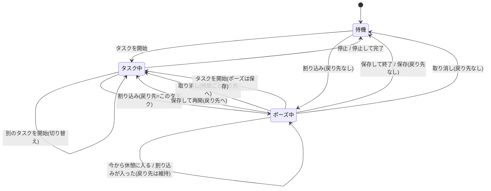

# 操作ロジック

作成日: 2026-11-17
対象: 個人運用 Web v1(`src/state/tasks.js`、`src/state/interruptsBreaks.js`、`src/state/pauseEvents.js`、`src/state/runningResolution.js`、`src/components/sheets/`、`src/app/controller.js`)

## 1. 大原則

1. **同時に動くものは1つだけ。** `running` は「なし」「タスク」「割り込み」「休憩」のどれか1つ。
2. **時間は途切れずにつながる。** 何かを始めると、それまで動いていたものはその時刻で閉じて記録になる。どの経路で閉じても、入力済みの内容(誰から、件名、メモなど)はそのまま記録に残る。
3. **割り込みと休憩は「戻り先」を覚えている。** タスク中に割り込むと、そのタスクが戻り先になる。割り込みから休憩へ(またはその逆へ)切り替えても、戻り先は最初のタスクのまま。戻り先のタスクが削除・完了されたら、戻り先はなくなる。
4. **「取り消し」はなかったことにする。** 割り込みや休憩を取り消すと記録は残らず、その時間は戻り先のタスクの時間に戻る。
5. **押せなかった瞬間は後から直す。** 押し遅れは保存後に履歴で、記録し忘れは計測を止めずに履歴で、止め忘れは時刻を選んで止めて直す(第4節)。

画面の言葉は「タスク」「割り込み」「休憩」の3つだけを使う。割り込みと休憩はコード上どちらも「ポーズ」で、同じシート(割り込み・休憩シート)で扱う。

## 2. 状態

| 状態 | 中身 | 画面の見え方 |
|---|---|---|
| 待機 | 何も動いていない | 実行バーなし。入力カードに「割り込み」ボタン |
| タスク中 | タスク1つが計測中 | 白い実行バー(⏸ と ■)。カードに濃い枠 |
| 割り込み中 | 割り込みが計測中。戻り先タスクを持つことがある | 赤い実行バー(■ のみ) |
| 休憩中 | 休憩が計測中。戻り先タスクを持つことがある | 黄色い実行バー(■ のみ) |

## 3. 操作一覧

### タスク

「開始」はどの状態からでも同じ動きをする。動いているものを保存して閉じ、そのタスクを始める。

| 操作 | どこから | 待機 | タスク中 | ポーズ中 |
|---|---|---|---|---|
| 開始 | カードの ▶ | そのタスクを開始 | 今のタスクを閉じて切り替え | ポーズを入力内容のまま保存して開始 |
| 追加 | 入力カードの ＋ / Enter | 追加のみ | 追加のみ | 追加のみ |
| 追加して開始 | 入力カードの ▶、詳細シート | 追加して開始 | 追加して切り替え | ポーズを保存して、追加したタスクを開始 |
| 停止 | 実行バーの ■ → 停止シート | — | 「停止のみ」「停止して完了」、または「別の時刻で止める」 | — |
| 完了 | カードの ○ | 完了にする | 計測中のタスクなら止めてから完了 | 完了にする。戻り先だった場合、戻り先はなくなる |
| 編集 | カードの ✎、実行バーのタップ | 名前・カテゴリ・メモを変えると、過去の記録の表示もすべて変わる | 同左 | 同左 |
| 削除 | 編集シート | 削除 | 計測中なら閉じてから削除 | 戻り先なら戻り先から外す |
| 完了から戻す | 完了済みカード | 未完了に戻す。▶ なら戻して開始 | 同左 | 同左(ポーズは保存) |

### 割り込み・休憩シート

開く方法はすべて同じシートにつながる: 入力カードの「割り込み」、実行バーの ⏸、ポーズ中の実行バーのタップと ■。

| ボタン | 何が起きるか |
|---|---|
| 今から休憩に入る(割り込み中) / 割り込みが入った(休憩中) | 今のポーズを入力内容で記録して閉じ、もう一方を今から始める。戻り先は維持 |
| カテゴリ | 今のポーズのカテゴリを変える。割り込みと休憩の2行に分かれていて、もう一方の行を選ぶと**開始時刻にさかのぼって**その種類に変わる(押し間違いの訂正用。「今から」切り替えるときは上のボタンを使う) |
| 発信者・件名・メモ | 割り込みのときだけ発信者と件名が出る。休憩はメモのみ |
| 保存して再開 | 記録して戻り先タスクを再開する(戻り先があるときだけ表示) |
| 保存して終了 | 記録して待機になる(戻り先があるときだけ表示) |
| 保存 | 記録して待機になる(戻り先がないときに表示) |
| 取り消し | 記録を残さない。戻り先があればその時間ごと戻り先タスクに戻し、なければ待機になる |
| × / 背景タップ / Esc | シートを閉じるだけ。計測は続く |

### 取り消しの時間の扱い

- 割り込みを1回して取り消した場合: 割り込み前のタスクの記録が途切れずに続く(記録は1件のまま)。
- 割り込みから休憩へ切り替えたあとに取り消した場合: すでに記録された割り込みは残り、取り消した分の時間だけがタスクの時間になる。

### 記録の名前

入力が空のまま閉じたポーズは、選んでいたカテゴリ名で記録される。カテゴリもない場合は「未記録の割り込み」「未記録の休憩」になる。

## 4. 時刻の後追い修正

### 押し遅れ: 保存してから履歴で直す

計測中の割り込み・休憩はまだ記録になっていないので、その場では開始時刻を変えられない。保存したあと、履歴でその記録の開始時刻を早めれば、重なった分は直前のタスクの記録から差し引かれる。

### 記録し忘れ: 計測中でも過去の記録を足せる

履歴の「押し忘れ」や記録の編集は、計測中のタスクの時間帯にも書き込める。

- 計測中のタスクは「今」で一度区切って扱い、足した記録の部分を切り取る。今につながる残りの部分がそのまま計測を続ける。
- 足した記録が「今」まで続く場合、タスクは今から計測を再開する。
- 書き込めないのは、これから先の時間、計測中の割り込み・休憩の時間帯、計測中のタスクの記録そのもの。

### 止め忘れ: 検知と、時刻を選んで止める

次のどちらかに当てはまると、タスク画面の上に「計測が○時間続いています。止め忘れていませんか？」が出る。

| 条件 | 止める時刻の初期値 |
|---|---|
| 作業時間を設定していて、その日の終了時刻より前に始めた計測が、終了時刻を30分以上過ぎても続いている | その日の終了時刻 |
| 作業時間を設定していない、またはその日の終了時刻より後に始めた計測が、4時間以上続いている | 今 |

作業時間内に始めた計測は、何時間続いても終了時刻を過ぎるまでは警告しない(長い集中作業を止め忘れと誤認しないため)。

「止めた時刻を選ぶ」(停止シートの「別の時刻で止める」からも開ける)で選んだ時刻までを記録して計測を終える。タスクはその時刻で止まり、割り込み・休憩は入力済みの内容のまま保存される。選べるのは計測の開始から今までの間。

## 5. 削った機能(2026-11-17)

「基本はタイマー」の方針で、次を画面から外した。保存済みのデータ(過去の記録の緊急度、休憩の目安分数、タスクの割り込み由来の印など)は消さずに残している。

| 機能 | 代わり |
|---|---|
| 割り込みの開始を早める | 保存後に履歴で開始時刻を直す |
| 緊急度(入力、履歴の表示、振り返りの緊急度別カード、CSV の列) | なし |
| 次の活動へ(別の割り込み / 休憩を始める) | 「今から休憩に入る / 割り込みが入った」の1ボタン。割り込みどうしの区切りは後から履歴で |
| この件をタスクにする | 割り込みを保存してからタスクを追加する |
| 休憩の目安時間(シートの分数指定、カテゴリ設定の目安、超過時の色) | なし |
| アクセントカラーの設定 | 固定の色 |

