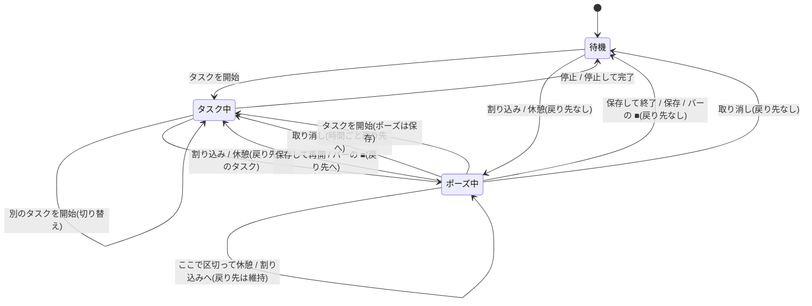

# 操作ロジック

作成日: 2026-11-17
対象: 個人運用 Web v1(`src/state/tasks.js`、`src/state/interruptsBreaks.js`、`src/state/pauseEvents.js`、`src/state/runningResolution.js`、`src/components/sheets/`、`src/app/controller.js`)

## 1. 大原則

1. **同時に動くものは1つだけ。** `running` は「なし」「タスク」「割り込み」「休憩」のどれか1つ。
2. **時間は途切れずにつながる。** 何かを始めると、それまで動いていたものはその時刻で閉じて記録になる。どの経路で閉じても、入力済みの内容(誰から、件名、メモなど)はそのまま記録に残る。
3. **割り込みと休憩は「戻り先」を覚えている。** タスク中に割り込むと、そのタスクが戻り先になる。割り込みから休憩へ(またはその逆へ)切り替えても、戻り先は最初のタスクのまま。戻り先のタスクが削除・完了されたら、戻り先はなくなる。
4. **「取り消し」はなかったことにする。** 割り込みや休憩を取り消すと記録は残らず、その時間は戻り先のタスクの時間に戻る。結果が戻り先の有無で変わるので、押すと「その時間がどうなるか」を示して確認する。
5. **押せなかった瞬間は後から直す。** 押し遅れは保存後に履歴で、記録し忘れは計測を止めずに履歴で、止め忘れは時刻を選んで止めて直す(第4節)。

画面の言葉は「タスク」「割り込み」「休憩」の3つだけを使う。割り込みと休憩は別の操作で、押した瞬間からその種類で計測する。割り込みにはカテゴリ(電話・チャットなど)があり、休憩にはない。コード上はどちらも「ポーズ」で、同じシート(割り込み・休憩シート)で扱う。

## 2. 状態

| 状態 | 中身 | 画面の見え方 |
|---|---|---|
| 待機 | 何も動いていない | 実行バーなし。入力カードに「割り込み」「休憩」 |
| タスク中 | タスク1つが計測中 | 白い実行バー(⚡ で割り込み、■ で停止)。入力カードに「休憩」。カードに濃い枠 |
| 割り込み中 | 割り込みが計測中。戻り先タスクを持つことがある | 赤い実行バー(■ で終える)。戻り先のカードに「再開待ち」 |
| 休憩中 | 休憩が計測中。戻り先タスクを持つことがある | 黄色い実行バー(■ で終える)。戻り先のカードに「再開待ち」 |

## 3. 操作一覧

### タスク

「開始」はどの状態からでも同じ動きをする。動いているものを保存して閉じ、そのタスクを始める。

| 操作 | どこから | 待機 | タスク中 | ポーズ中 |
|---|---|---|---|---|
| 開始 | カードの ▶ | そのタスクを開始 | 今のタスクを閉じて切り替え | ポーズを入力内容のまま保存して開始 |
| 追加 | 入力カードの ＋ / Enter | 追加のみ | 追加のみ | 追加のみ |
| 追加して開始 | 入力カードの ▶、詳細シート | 追加して開始 | 追加して切り替え | ポーズを保存して、追加したタスクを開始 |
| 停止 | 実行バーの ■ → 停止シート | — | 「停止のみ」「停止して完了」、または「別の時刻で止める」 | — |
| 完了 | カードの ○ | 完了にする | 計測中のタスクなら止めてから完了 | 完了にする。戻り先だった場合、戻り先はなくなる |
| 編集 | カードの ✎、実行バーのタップ | 名前・カテゴリ・メモを変えると、過去の記録の表示もすべて変わる | 同左 | 同左 |
| 削除 | 編集シート | 削除 | 計測中なら閉じてから削除 | 戻り先なら戻り先から外す |
| 完了から戻す | 完了済みカード | 未完了に戻す。▶ なら戻して開始 | 同左 | 同左(ポーズは保存) |

### 割り込み・休憩シート

始め方:

| 入口 | 何もしていない | タスク中 | 割り込み・休憩中 |
|---|---|---|---|
| 入力カード(タスクを書いていないとき) | 「割り込み」「休憩」 | 「休憩」 | なし |
| 実行バー | — | ⚡ = 割り込み | タップでシートを開く。■ はシートの主ボタンと同じく、記録して戻り先へ戻る(戻り先がなければ記録して待機) |

休憩は割り込みほど急いで押すものではないので、実行バーには置かない。

入力カードは、入力欄に触れるかタスク名を書き始めると「タスクを書く場所」に変わる。割り込み・休憩のボタンは隠れ、入力欄が横幅いっぱいに広がり、詳細(…)とカテゴリが出る。

| ボタン | 何が起きるか |
|---|---|
| ここで区切って休憩に入る / ここで区切って割り込みに移る(タイマーの下) | 今の時刻で区切って記録し、もう一方を今から始める。記録は2件になり、戻り先は維持。入力カードの「休憩」と同じ操作 |
| カテゴリ(電話・チャット・質問・その他 ｜ 休憩) | このタイマーが何なのかを選ぶ。割り込みのカテゴリと「休憩」が1列に並び、選ぶとタイマーの**始まりから**その内容に付け替わる。記録は1件のまま。押し間違いの訂正もここで行う |
| 発信者・件名・メモ | 割り込みは発信者・件名・メモ、休憩はメモのみ |

タイマーの下には、計測の開始時刻(○○:○○から)を表示する。区切って新しく始めた割り込みは、前の割り込みの入力を引き継がず空で始まる。

| ボタン | 何が起きるか |
|---|---|
| 保存して再開 | 記録して戻り先タスクを再開する(戻り先があるときだけ表示) |
| 保存して終了 | 記録して待機になる(戻り先があるときだけ表示) |
| 保存 | 記録して待機になる(戻り先がないときに表示) |
| 取り消し | 記録を残さない。戻り先があればその時間ごと戻り先タスクに戻し、なければ待機になる。押すと結果を示す確認に変わり、「取り消す」で確定する |
| × / 背景タップ / Esc | シートを閉じるだけ。計測は続く |

### 取り消しの時間の扱い

- 割り込みを1回して取り消した場合: 割り込み前のタスクの記録が途切れずに続く(記録は1件のまま)。
- 割り込みから休憩へ切り替えたあとに取り消した場合: すでに記録された割り込みは残り、取り消した分の時間だけがタスクの時間になる。

### 記録の名前

入力が空のまま閉じた割り込み(実行バーの ■ で終えた場合も含む)は、選んでいたカテゴリ名で記録される。カテゴリもない場合は「未記録の割り込み」になる。休憩は常に「休憩」で記録される。

## 4. 時刻の後追い修正

### 押し遅れ: 保存してから履歴で直す

計測中の割り込み・休憩はまだ記録になっていないので、その場では開始時刻を変えられない。保存したあと、履歴でその記録の開始時刻を早めれば、重なった分は直前のタスクの記録から差し引かれる。

### 記録し忘れ: 計測中でも過去の記録を足せる

履歴の「押し忘れ」や記録の編集は、計測中のタスクの時間帯にも書き込める。

- 計測中のタスクは「今」で一度区切って扱い、足した記録の部分を切り取る。今につながる残りの部分がそのまま計測を続ける。
- 足した記録が「今」まで続く場合、タスクは今から計測を再開する。
- 書き込めないのは、これから先の時間、計測中の割り込み・休憩の時間帯、計測中のタスクの記録そのもの。

### 止め忘れ: 検知と、時刻を選んで止める

次のどちらかに当てはまると、タスク画面の上に「計測が○時間続いています。止め忘れていませんか？」が出る。

| 条件 | 止める時刻の初期値 |
|---|---|
| 作業時間を設定していて、その日の終了時刻より前に始めた計測が、終了時刻を30分以上過ぎても続いている | その日の終了時刻 |
| 作業時間を設定していない、またはその日の終了時刻より後に始めた計測が、4時間以上続いている | 今 |

作業時間内に始めた計測は、何時間続いても終了時刻を過ぎるまでは警告しない(長い集中作業を止め忘れと誤認しないため)。

「止めた時刻を選ぶ」(停止シートの「別の時刻で止める」からも開ける)で選んだ時刻までを記録して計測を終える。タスクはその時刻で止まり、割り込み・休憩は入力済みの内容のまま保存される。選べるのは計測の開始から今までの間。

## 5. 削った機能(2026-11-17)

「基本はタイマー」の方針で、次を画面から外した。保存済みのデータ(過去の記録の緊急度、休憩の目安分数、タスクの割り込み由来の印など)は消さずに残している。

| 機能 | 代わり |
|---|---|
| 割り込みの開始を早める | 保存後に履歴で開始時刻を直す |
| 緊急度(入力、履歴の表示、振り返りの緊急度別カード、CSV の列) | なし |
| 次の活動へ(別の割り込み / 休憩を始める) | 「休憩に入る / 割り込みが入った」の1ボタン。割り込みどうしの区切りは後から履歴で |
| この件をタスクにする | 割り込みを保存してからタスクを追加する |
| 休憩の目安時間(シートの分数指定、カテゴリ設定の目安、超過時の色) | なし |
| 休憩のカテゴリ(休憩・昼食・私用) | 休憩は1種類。古いデータにある休憩のカテゴリ（割り込みに変わってしまったものも含む）は読み込み時に外す。休憩の記録そのものは残る |
| アクセントカラーの設定 | 固定の色 |

## 6. 表示の決まり(2026-11-18)

- **呼び名は「記録」。** 履歴に残るものは種類を問わず「記録」と呼ぶ(「イベント」「作業記録」は使わない)。編集シートは「記録を編集」、追加シートは「押し忘れを記録」。
- **期限は日時で出す。** タスクカードの期限は「期限 今日 18:00」「期限切れ 昨日 9:00」のように出し、残り時間と読み違えないようにする。
- **時間は1か所。** 計測中のタスクの経過は、カードの「実績/累計」(計測中の分も含む)と実行バーの時計で示す。カードに秒の時計は出さない。
- **時刻の入力は日時の入力欄。** 押し忘れの追加、記録の編集、止めた時刻の指定はどれも日時の入力欄を使う。
- **消す操作はその場で確認する。** タスク・記録・カテゴリの削除と割り込み・休憩の取り消しは、シートの下部が確認に切り替わる。確定ボタンだけが赤い塗り、その手前の「削除」は赤い文字。
- **選ぶものは1種類のチップ。** カテゴリ・発信者・件名・見積・期限など、シートで1つ選ぶものはすべて同じ白いチップで、選んだものが黒く塗られる。カテゴリの色はチップの中の点だけに出す。
- **経過時間は 00:00:00。** 実行バー、割り込み・休憩シート、停止シートで同じ書き方。時刻の範囲は「09:30 – 09:50」(1分未満の記録だけ秒も出す)。
- **シート中はタブバーを押せない。** タブバーもシートの背景と同じく暗くなる。
- **重なった記録の整理は勝手に開かない。** 履歴・振り返り・設定の警告から開く。
- **閉じるボタンは「キャンセル」、前のシートや確認から戻るときは「戻る」。** フッターのボタンに絵は付けない。
- **補足ラベルや説明文は置かない。** 並びと色と絵で分かるようにし、文字で残すのは今の値・警告・消す操作の結果・保存場所の事実だけ。
- **時間の書き方は「3h 55m」。** 振り返りの大きな数字も同じ。1分未満は「23s」、ゼロは「0m」。
- **日付の移動は同じ部品。** 履歴と振り返りはどちらも ‹ 今日 › と日付選びのボタン。
- **複数のタブで開いても上書きしない。** 別のタブが保存すると、このタブはその内容に入れ替わる(入れ替えた内容を書き戻さない)。
- **保存したら知らせる。** 履歴側の保存・追加・削除と、実行バーの ■ で終えたときは通知を出す。
- **期限順のまま並べ替えると期限順を解除する。** 見えている順番のまま動かし、その順番を手動の並びとして残し、通知で知らせる。

## 7. 勤務日と終わる目安(2026-11-20)

### 勤務日

- 設定の「基本の作業時間」で、曜日ごとに勤務日を選ぶ(初期値は月〜金)。
- 休みの日はその日の作業時間を持たない。タスク画面の上は「今日は休み」と出る。
- 休みの日でも、その日の終了時刻を自分で決めると、その日だけ勤務日になる。基本に戻すと休みに戻る。

### 残業と休日出勤

振り返りの「基本の作業時間」カードは、どの期間(日・週・月・年)でも次の3つに分ける。

| 区分 | 中身 |
|---|---|
| 時間内 | 勤務日の作業時間の中のタスク・割り込み |
| 残業 | 勤務日の開始前と終了後のタスク・割り込み(あるときだけ強調) |
| 休日出勤 | 休みの日のタスク・割り込み(あるときだけ出す) |

### 終わる目安(`src/features/forecast/forecast.js`)

「残業なしで、いつもどおりに進めたら、いつ終わるか」を出す。

1. 使える時間: 勤務日の作業時間だけ(今日は今から終了まで)。
2. 普段の割り込みと休憩: 直近2週間の勤務日(記録のある日)で、作業時間の中の割り込みと休憩の割合を出し、その分を差し引く。記録が5日分たまるまでは差し引かない。
3. 見積の当たり具合: 直近60日に完了したタスクの「実績 ÷ 見積」で残りの見積を伸び縮みさせる(0.5〜3倍)。3件たまるまでは見積どおり。
4. 4時間以上続いた記録は止め忘れとみなし、2と3の計算に入れない。
5. 見積のあるタスクを期限の近い順に、使える時間へ前から詰めて、終わる日を出す。期限までに積み上がった残りが使える時間を超えた分が「不足」。期限のないタスクは最後に詰める。見積のないタスクは入れない。
6. 期限をもう過ぎたタスクは「不足」ではなく「期限切れ」。先に片付ける前提で時間は使うが、不足の計算には入れない。
7. 実績が(倍率をかけた)見積に届いたのに終わっていないタスクは、残りが読めないので目安の日を出さず「見込み超過」とする。見積を直せば、また目安が出る。

表示:

- タスクカードの2行目に「期限 … · 目安 …」。間に合わないときは赤く、「◯ 不足」を足す。
- 一覧の上に、いちばん近い間に合わない期限を1行で出す。なければ期限切れの件数を出す(作業時間が未設定でも出る)。押すと「終わる目安」シートで、タスクごとの目安と、計算に使った値(1日のうち割り込み・休憩を除いた時間、見積の倍率)が見られる。
- 間に合う見込みのときは、目安の日だけを出す。

